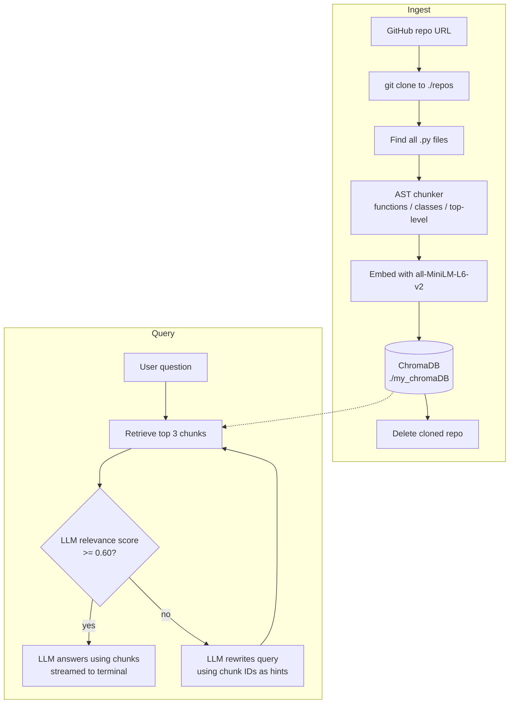

# Codebase Q&A Bot

A command-line tool that lets you ask natural-language questions about any public GitHub repository. It clones a repo, splits the Python code into meaningful chunks (functions, classes, top-level code), stores them in a local vector database, and answers your questions with an LLM using only the most relevant code.

What makes it more than a basic RAG script is the **self-correcting retrieval loop**: the LLM scores how relevant the retrieved code is, and if the score is low, it rewrites your query and tries again before answering.

---

## Features

- **One-command ingestion** of any public Git repo (cloned temporarily, then deleted).
- **AST-based chunking** of Python files: functions, async functions, classes and top-level code each become their own chunk, with metadata (file, type, name, start/end line).
- **Local vector store** using ChromaDB with `all-MiniLM-L6-v2` sentence embeddings. No external embedding API needed.
- **LLM relevance check**: retrieved chunks are scored from 0 to 1 before being used.
- **Automatic query rewriting** when relevance is low (up to 2 retries).
- **Pluggable LLM backend**: choose Gemini, Qwen, MiniMax or GLM at runtime via any OpenAI-compatible endpoint.
- **Streaming answers** in a clean terminal UI (Rich + Questionary).

---

## How It Works



### Query flow in detail

1. The question is embedded and the **top 3** most similar chunks are fetched from ChromaDB.
2. A short preview (first 50 characters) of each chunk is printed.
3. The LLM receives the query, the chunks, and the IDs of every chunk in the database, and returns a JSON relevance score between 0 and 1.
4. If the score is **>= 0.60**, the LLM explains the code and streams the answer.
5. If the score is **< 0.60**, the LLM uses the list of chunk IDs (which encode file and function names) to generate a better search query, and the loop repeats.
6. The retry limit is 2. After that, the bot prints `Max try exceed.`

---

## Project Structure

```
Project_7_Codebase_QandA_Bot/
├── main.py            # CLI entry point, model selection, ingest + query orchestration, LLM prompts
├── chunker.py         # AST-based Python code chunking
├── chunk_store.py     # Embeds chunks and writes them to ChromaDB
├── chunk_retrieve.py  # Similarity search and chunk ID listing from ChromaDB
├── config.toml        # LLM provider configuration
├── .gitignore         # Ignores .env, my_chromaDB, __pycache__, .vscode, trial.py
└── my_chromaDB/       # Local vector database (created on first ingest)
```

| File | Responsibility |
|------|----------------|
| `main.py` | Parses CLI args, shows the model picker, clones/ingests repos (`repo_handler`), scores chunks (`chunk_eval`), rewrites queries (`query_generator`), and runs the retrieve-score-answer loop (`query_handler`). |
| `chunker.py` | `chunk_python_code()` parses source with `ast` and returns parallel lists of `chunks`, `metadatas` and `ids`. |
| `chunk_store.py` | `embed_store()` adds chunks to the `code_snippet` collection. |
| `chunk_retrieve.py` | `relevent_chunks()` runs the similarity query; `get_ids()` returns all stored chunk IDs. |

### Chunk format

Each chunk is stored with metadata:

```json
{
  "file_name": "chunker.py",
  "type": "function",
  "name": "chunk_python_code",
  "start_line": 11,
  "end_line": 68
}
```

IDs follow the pattern `<file_name>__<function_or_class_name>__<index>`; top-level code uses `<file_name>_top_level__<index>`.

---

## Tech Stack

- **Python 3.12+** (uses `tomllib` and `shutil.rmtree(onexc=...)`)
- **ChromaDB**: persistent local vector database
- **sentence-transformers** (`all-MiniLM-L6-v2`): embeddings
- **OpenAI Python SDK**: client for any OpenAI-compatible API
- **Rich** and **Questionary**: terminal UI and model selector
- **python-dotenv**: API key loading
- **Git** must be installed and on your PATH

---

## Setup

### 1. Clone

```bash
git clone https://github.com/satyam-sharma7/Project_7_Codebase_QandA_Bot.git
cd Project_7_Codebase_QandA_Bot
```

### 2. Install dependencies

```bash
python -m venv venv
source venv/bin/activate        # Windows: venv\Scripts\activate
pip install chromadb sentence-transformers openai questionary python-dotenv rich
```

### 3. Add API keys

Create a `.env` file in the project root with the key(s) for the model(s) you plan to use:

```env
OPENROUTER_API_KEY=your_key      # MiniMax
GOOGLE_AI_STUDIO=your_key        # Gemini
HF_TOKEN=your_key                # GLM (Hugging Face router)
HF_TOKEN_2=your_key              # Qwen (Hugging Face router)
```

You only need the key for the model you select.

---

## Usage

### Ingest a repository

```bash
python main.py ingest --repo https://github.com/user/some-repo.git
```

The repo is cloned into `./repos/`, every `.py` file is chunked and embedded, and the clone is deleted. You will see a summary such as `Found 12 Python files, 87 chunks`.

### Ask a question

```bash
python main.py query "How does the authentication middleware work?"
```

On every run you will be asked to pick an LLM (Gemini, Qwen, MiniMax or GLM). The bot then retrieves, scores, optionally rewrites the query, and streams its answer.

---

## Configuration

Models are defined in `config.toml`. Each entry has a provider, an OpenAI-compatible base URL, the name of the environment variable holding the key, and the model name:

```toml
[models.gemini]
provider = "Gemini"
url = "https://generativelanguage.googleapis.com/v1beta/"
api = "GOOGLE_AI_STUDIO"
name = "gemini-3-flash-preview"
temperature = 0.3
max_tokens = 500
```

To add a model, add a new `[models.<key>]` block and add the matching label to the `choices` list in `main.py`. Note that the selected label is lower-cased to look up the config key.

Other tunables, currently hard-coded in the source:

| Setting | Value | Location |
|---------|-------|----------|
| Embedding model | `all-MiniLM-L6-v2` | `chunk_store.py`, `chunk_retrieve.py` |
| Chunks retrieved (`top_k`) | 3 | `chunk_retrieve.py` |
| Relevance threshold | 0.60 | `main.py` (`query_handler`) |
| Max query rewrites | 2 | `main.py` (`query_handler`) |
| Collection name | `code_snippet` | `chunk_store.py`, `chunk_retrieve.py` |
| Vector DB path | `./my_chromaDB` | `chunk_store.py`, `chunk_retrieve.py` |

---

## Known Limitations

This is a learning project, and the following are known gaps:

- **Python only.** Other languages are not chunked (noted as a TODO in `chunker.py`).
- **Top-level chunking only.** Methods inside a class are part of the class chunk, not separate chunks. A file with a syntax error will fail at `ast.parse`.
- **Filename-based IDs.** IDs use the file name, not the full path, so files with the same name in different folders (e.g. `__init__.py`) can collide.
- **No de-duplication.** Ingesting the same repo twice attempts to re-add the same IDs, and chunks from multiple repos share one collection, so answers can mix repos.
- **Fixed top 3.** The answer step assumes exactly three retrieved chunks; a very small collection will raise an index error.
- **Retry edge case.** If the final allowed retry produces a good score, the bot still reports `Max try exceed.` instead of answering.
- **Config values not applied.** `temperature` and `max_tokens` are in `config.toml` but are not yet passed to the API calls.
- **Gemini endpoint.** Gemini's OpenAI-compatible endpoint normally ends in `/v1beta/openai/`; the current URL may need updating if requests fail.
- **Model picker on every command**, including `ingest`, where the LLM is not used.

---

## Roadmap

- Support more languages (JavaScript/TypeScript, Java, etc.) via tree-sitter
- Chunk class methods individually and add docstring/signature metadata
- Use full relative paths in IDs and a per-repo collection
- Pass `temperature` / `max_tokens` from config and add a `--model` CLI flag
- Add a `requirements.txt` and tests
- Interactive chat mode with conversation history

---

## Author

**Satyam Sharma**
GitHub: [satyam-sharma7](https://github.com/satyam-sharma7) · LinkedIn: [satyam-sharma](https://www.linkedin.com/in/satyam-sharma-778383379/)